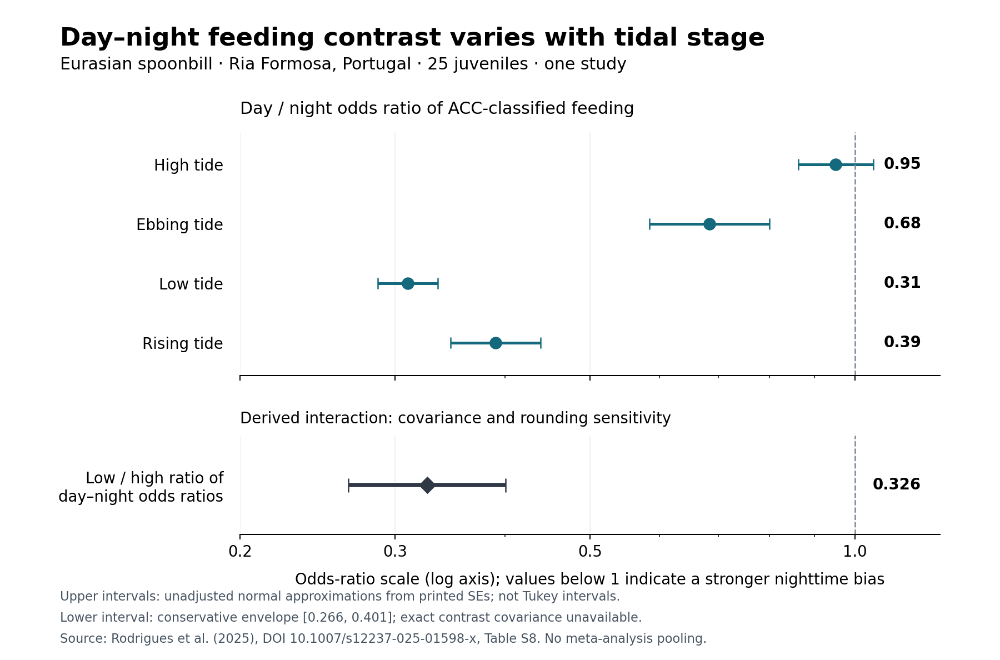

# v133：潮汐×昼夜の効果量抽出と、複数分類群の原著監査

作成日：2026-11-14 JST。v131 の統合方針と v132 の文献母集団を引き継ぐ。今回の結果は**公表済み結果の抽出・再計算**であり、新しい野外観測や個体データモデルではない。

## 今回得られた結果

**文献候補の列挙から、潮汐によって昼夜差がどの程度変わるかを数値で扱う段階へ進んだ。** ポルトガルのヘラサギでは、Ria Formosa の干潮時に夜間採餌への偏りが強いことを、原著の補足表から再計算できた。カナダのアザラシでは、原著の標準化尺度で潮汐×昼夜、および放流後の期間との三重交互作用を抽出できた。中国のイルカでは方向を持たない交互作用検定を確認した。[1–3]

ただし、これらは同じ単位・同じ応答ではない。**世界共通の統合効果は `NOT_ESTIMATED` のまま**である。実際に得られた進展は、数値、出典、依存関係、統合できない理由まで追跡できる効果記録である。

| 作業 | v133 の実績 | この数が意味しないもの |
|---|---:|---|
| v132 の文献メタデータ母集団 | 1,061件 | 全件の全文適格性判定ではない |
| 以前に野外候補とされた文献の取得監査 | 150件＝潮汐×太陽候補93件＋潮汐候補57件 | 150件の採択ではない |
| DOIが一致した全文XML取得 | 86件 | 86独立研究の採択ではない |
| 個別に内容・効果尺度を調べた原著 | 17研究 | 全文取得86件の全数スクリーニングではない |
| ヘラサギ補足表の数値抽出 | 174比較、うち採餌60比較 | 174独立効果・60独立研究ではない |
| 符号付きの潮汐×昼夜情報 | ヘラサギの差の差、アザラシの回帰係数 | 共通尺度の2研究メタ解析ではない |
| その他の交互作用情報 | 中国イルカの4応答のオムニバス検定 | 4独立研究・4方向付き効果ではない |

集計の根拠は[全文取得記録](../validation_v133/results/fulltext_access_audit.json)、[17研究の出典索引](../validation_v133/source_evidence_index.json)、[数値抽出台帳](../validation_v133/published_spoonbill_effect_ledger.json)に残した。17研究は目的を定めた個別監査集合であり、150件の取得監査とは別の集合である。

## 1．ヘラサギ：干潮時に夜間採餌への偏りが強い

Rodrigues et al. (2025) は、加速度から分類した採餌・休息・羽繕いを、潮汐と昼夜のカテゴリーに対応づけている。44羽に装着し、解析対象は35羽。その内訳は Tagus 10羽、Ria Formosa 25羽である。個体IDをランダム効果としたモデルを用いている。[1]

原著補足 Table S7/S8 の174比較を抽出し、別の読取りとの照合でも、比較ラベル・推定値・SE等の転記に差がないことを確認した。同じ研究・同じモデルから得た比較なので、行数を独立標本数に読み替えない。

### 潮位ごとの昼／夜の採餌オッズ比

Ria Formosa の Table S8-A にある **day − night の対数オッズ差**をそのまま使った。

| 潮汐区分 | 公表された対数オッズ差 β | 公表SE | exp(β)：昼／夜オッズ比 | 公表Tukey補正p |
|---|---:|---:|---:|---:|
| 満潮 | −0.05 | 0.05 | 0.951 | 0.82 |
| 下げ潮 | −0.38 | 0.08 | 0.684 | <0.0001 |
| 干潮 | −1.17 | 0.04 | 0.310 | <0.0001 |
| 上げ潮 | −0.94 | 0.06 | 0.391 | <0.0001 |

オッズ比が1未満なら、その潮汐条件で昼の採餌オッズが夜より低い。干潮と上げ潮で夜への偏りが大きく、満潮では昼夜差は小さい。ただし、これは**観測されたfixが採餌に分類されるオッズ**であり、採餌時間や摂取量の倍率ではない。[1]



上段の線は公表SEから計算した未補正の正規近似区間で、Tukeyの同時区間ではない。下段は後述する共分散と丸めの感度範囲である。

### 干潮と満潮で昼夜差がどの程度違うか

今回計算した対比は次である。

\[
\theta=(D-N)_{\rm low}-(D-N)_{\rm high}
=-1.17-(-0.05)=-1.12.
\]

したがって、昼／夜オッズ比の「干潮／満潮比」は

\[
\exp(\theta)=0.32628.
\]

これは干潮時の夜への偏りが満潮時より強いという、**原著の推定値から導いた交互作用対比**である。

二つの比較は同じモデルに由来するが、その共分散は公開されていない。独立と仮定したSEは使わない。周辺SEをそれぞれ \(s_a,s_b\) とすると、

\[
\mathrm{Var}(a-b)=s_a^2+s_b^2-2\mathrm{Cov}(a,b),\qquad
|s_a-s_b|\leq SE(a-b)\leq s_a+s_b.
\]

公表値では **SEの範囲は0.01–0.09**。上限SEで正規近似すると、対数尺度の包絡範囲は **[−1.2964, −0.9436]**、比の尺度では **[0.274, 0.389]** となる。さらに、各数値が表示された小数桁で四捨五入されていると仮定すると、対比は[−1.13, −1.11]、SE上限は0.10となり、比の包絡範囲は **[0.266, 0.401]** へ広がる。

この範囲は、原著モデルと正規近似を前提とした保守的な感度評価である。**公表された厳密な95%信頼区間、モデル選択を補正した区間、因果効果ではない。** 台帳には `sampling_se=null` を残し、逆分散重みには使わない。[計算結果](../validation_v133/results/spoonbill_tide_diel_contrasts.json)

### 解釈上の制約と原著内の不整合

- 原著では日の出・日の入りの前後各1.5時間を移行時間帯とし、昼と夜から分けている。干潮・満潮の前後各2時間をそれぞれの区分とし、その間が上げ潮・下げ潮となる。単に「4区分」と一致する他研究とは同一視しない。
- 装置の記録は昼間に偏り、年によって記録間隔も異なる。補足表から確認したfix総数は Tagus 19,809、Ria Formosa 70,855であり、これらは採餌成功回数や独立個体数ではない。
- Tagus の採餌上位モデルは加法モデルで、交互作用を推定していない。交互作用ゼロの精密な観測として登録しない。Tagus の満潮−干潮比較は β=−0.0821、SE=0.0381、Tukey p=0.1358。未補正Wald区間だけを根拠に有意と変更しない。
- 同じ補足表で異なる数値に同一比較ラベルが繰り返される行が28行あり、採餌では10行ある。原著ラベルを推測で修正せず、曖昧として保持する。今回の主要な4つの昼夜比較はこの問題に該当しない。
- Tagus の羽繕いモデルは昼夜のみ。休息では交互作用モデルと加法モデルがともにΔAICc<2で、モデル平均と最良モデルの対比較に関する本文の記述だけでは Table S7 の由来を一意に決められない。休息の数値は保持し、モデル由来未解決として統合対象から外す。[1]

## 2．アザラシ：標準化された潮汐反応が昼夜と放流後期間によって異なる

Allegue et al. (2020) はカナダの Big Qualicum 河口で、加速度から検出した prey encounter event（PEE）を調べている。全体の装着20頭、全解析のデータが揃った17頭に対し、対象ホットスポットでの Table 2 モデルは**7頭・1河口**である。PEEは餌との遭遇の代理指標で、捕食成功そのものではない。[2]

Table 2A は、1時間内に1回以上PEEがあるかを扱う二項logitモデルで、参照は昼・coho放流後期間である。

| 原著の項 | β | 公表SE | 位置づけ |
|---|---:|---:|---|
| Tide × Night | +0.9 | 0.3 | coho放流後期間における、標準化潮位の夜と昼の傾きの差 |
| Tide × Dawn | +0.6 | 0.5 | 同期間の明け方と昼の差 |
| Tide × Dusk | +2.1 | 0.9 | 同期間の夕方と昼の差 |
| Tide × Night × Post-Chinook | −1.1 | 0.4 | 次の放流後期間における夜の交互作用係数の変化 |
| Tide × Dawn × Post-Chinook | −0.1 | 0.7 | 同、明け方 |
| Tide × Dusk × Post-Chinook | −2.2 | 1.1 | 同、夕方 |

これらは一つのモデルの相関した係数である。潮位は**昼夜の区分ごとに別々に標準化**されている。従って、同じ物理的1 mに対する傾きの差ではなく、ヘラサギの干潮−満潮対比とも尺度が違う。元の区分別平均・SDか個体データが得られるまで共通尺度に変換しない。

また、原著の区間見出しは「CI: [25–95%]」と印刷されており、補足もこの曖昧さを解消しない。公表SEと区間端点は記録したが、区間を通常の95%CIと呼び替えていない。原著のモデル選択、PEEに基づくホットスポット選択、期間と日付・月相・餌種の重なりもあるため、「放流が潮汐依存性を因果的に変えた」とは結論しない。[2]

[哺乳類の抽出記録](../validation_v133/mammal_source_effect_audit.json)には原著・補足の所在、時間帯別標準化、モデルの参照水準、同一モデルへの依存を残した。

## 3．中国イルカ：交互作用は検定されているが、符号付きの効果ではない

Wang et al. (2015) の珠江河口の受動音響記録には、昼夜5区分×潮汐4区分の交互作用検定がある。Table 2–5 の該当行は次の通り。[3]

| 10分ごとの応答 | F(12, 16540) | 公表p |
|---|---:|---:|
| クリック列数 | 2.43 | 0.004 |
| クリックを含む分数 | 3.16 | 0.000と印刷；解釈は<0.001 |
| buzz数 | 1.45 | 0.134 |
| buzzを含む分数 | 2.48 | 0.003 |

有意でないbuzz数も保存した。これらは複数区分をまとめた検定であり、干潮時に夜間活動が増えるか減るかという方向や、その対比のSEは復元できない。Fやpを無理に対数オッズ比に変えない。

16,759区間は、127記録日・1観測点の時系列である。個体識別はなく、4応答も独立ではない。確認した方法記述には連続区間の自己相関への補正を見いだせなかったため、区間数を独立生物反復として解釈しない。[3]

## 4．他の原著を、何が測定されているかで分けた

ここでの「抽出不可」は潮汐効果がないという意味ではない。必要な**潮汐×昼夜の方向付き対比と不確実性**が、その原著の公表情報から得られないという意味である。各DOI・元ファイルのハッシュ・数値・出典位置は[17研究索引](../validation_v133/source_evidence_index.json)から辿れる。

| 研究・地域 | 確認できた情報 | 現在の対比と異なる点 |
|---|---|---|
| クロミヤコドリ・BC | 20羽、4地域の生息地選択 | 潮汐比較は昼間に限定；全日の採餌×昼夜ではない [4] |
| アデリーペンギン・南極 | 潮汐レジームの週単位の切替 | diurnal tideは1日1回の潮汐で、昼行性を意味しない [5] |
| マゼランペンギン・アルゼンチン | 27羽、1羽1採餌旅行、元CSVの実ヘッダーを確認 | 海流や餌追跡情報が事前結合済みとは確認できない [6] |
| カブトガニ・Florida | 潮位係数1.978、SE1.776；公表区間[−1.503,5.459] | 昼間・満潮付近の産卵個体数モデル、潮汐×昼夜ではない [7] |
| 混合魚群・Maine | 582観測日の魚通過記録、Dryadメタデータ | 潮汐を魚の遊泳方向から構成；元CSV未取得 [8] |
| Giant mud crab・豪州 | 18装着、13モデル対象、HMMの活動状態 | 潮汐を用いて推定した状態を、潮汐の独立検証用応答にできない [9] |
| ギンダラ・Alaska | 13装着、6解析、40日；鉛直移動の平均±2SE | 同じ魚の反復対比、共分散不明；昼夜条件付き対比ではない [10] |
| armed snook・Colombia | 大潮／小潮×昼夜の採餌・出現 | 日内潮位区分とは異なる；補足数値未取得 [11] |
| チュウゴクモクズガニ・Scheldt | 加速度6個体、下流移動；ebb/floodの予測値 | 相関した予測値の共分散が不明、昼夜差の差ではない [12] |
| バンドウイルカ・Scotland | 3地点1沿岸個体群の潮汐平滑項と昼夜×季節 | 潮汐×昼夜が選択されなかったことをゼロ効果にしない [13] |
| カブトガニ・日本 | 夜7.6±7.2 SD、昼2.9±3.5 SDの移動数 | 潮汐で条件付けていない昼夜比較；対比較の共分散不明 [14] |
| Cellana・Eilat | 季節内の昼夜の活動継続時間検定 | 平均・SEなし；実験室の時計や遺伝子リズムとは別の応答 [15] |
| Patella・Isle of Man | 干出・夜間への限界的な活動配分 | Table 2の交互作用は基質×岸の高さで、潮汐×昼夜ではない [16] |
| オマキザル・Panama | 真正の22,185カメラ検出系列 | 正の検出だけであり、観測努力を伴う無検出区間ではない [17] |

Floridaの生データ173調査では108調査がゼロ個体で、原著は欠測を含む3調査を除き170調査を解析したと記載する。CSVの `Tide` は全行にあり、`Onshore` 等には3行の欠測があるため、潮位欠損による除外とは特定しない。一方、Kelly地点の `CpM` と個体数から逆算した長さは596 mで、本文の213 mと一致しない。Parrishの597 mは一致する。地点内で一定のoffset差は地点切片に吸収され得るので、この不整合だけで原著の潮位係数を誤りとは判断しない。[元CSV監査](../validation_v133/florida_horseshoe_original_data_audit.json)

## 5．全文取得150件の結果と範囲

v132の元artifactを取得し、ZIPのSHA256と、内部の文献JSONのSHA256を確認してから、以前に指定された93＋57件だけを取得対象にした。新たな効果を見て候補の選定を変更していない。

| 取得結果 | 件数 | 扱い |
|---|---:|---|
| 元DOIと全文XMLが一致 | 86 | 内容審査の資料として利用可能 |
| メタデータは一致、PMC XML用IDなし | 44 | 論文全体の入手不能を意味しない |
| 原著XML取得のHTTPエラー | 19 | 全て当該試行では500；生物学的な除外理由にしない |
| XMLのDOI照合失敗 | 1 | 元と取得先の識別子差を保存し、勝手に置換しない |
| **合計** | **150** | 候補を落とさず1件1状態を記録 |

取得した86件のXML上の種別は、research-article 82、review-article 2、correction 1、case-report 1である。これは適格性分類ではない。語句の一致で選ばれた無関係な文献も残り得る。35件に潮汐語を含む表、23件に本文側のデータリポジトリ候補リンクを検出したが、表の効果量抽出や元データ取得の完了とは数えない。補足228件では、子要素に記載された実ファイルのlocatorを保持した。相対ファイル名を推測した絶対URLに変換していない。

残る911件には未確定405件等が含まれ、今回の150件の取得監査では調べていない。**PRISMAの完全な検索・全件二者判定は未完了**であり、選択された17研究から出版バイアスや全球の効果分布を推定しない。[取得記録](../validation_v133/results/fulltext_access_audit.json)

## 6．原データから先へ進むために確認できたこと

### オマキザルの真正データは取得したが、活動率には直結しない

Zenodo 8129505のオリジナルZIPは公表MD5に一致し、CSVは22,185系列・104カメラ地点、1系列あたり1–22個体で、ゼロ行はない。設置の開始・終了はあるが、稼働の中断を含む検証済み観測努力と無検出区間は揃っていない。元解析も潮汐モデルと時刻モデルを分けている。従って、検出されたときの個体数を無条件の活動率に読み替えたり、設置期間をすべて稼働時間としてゼロを埋めたりしない。[17／元ファイル監査](../validation_v133/results/capuchin_original_source_audit.json)

### 魚群データは長いが、潮汐と欠測の由来が重要

Maine論文の潮汐は魚の遊泳方向から構成されており、独立した物理環境系列と同一視できない。さらに原著のwavelet処理には周期成分とノイズによる欠測補完がある。IPD再解析には、観測された計数・努力・欠測フラグと、独立した潮汐系列を分けた入力が必要である。Dryadには元CSVのファイル情報があるが、公開ダウンロードは403で、今回は内容を取得できなかった。[8]

### ペンギンの元ヘッダーとメタデータは同一ではなかった

Figshare 28517873の `Penguins.csv` は実ヘッダーで10列を確認した。時刻、ID、加速度、深度、行動、位置等を含むが、説明文が列挙する32列や海流・餌追跡情報の全てが入っているわけではない。27羽・1旅行ずつのデータについて、別ファイルの海流と原著ワークフローとの対応を確認する必要がある。336 MBの全CSVを取得・解析したとは主張しない。[6]

これらは「件数が多いからモデルを回せる」という段階から、**実際に何を分母・応答・環境説明変数として使えるかが判定できた**という進展である。今回、新しい生データへの行動モデル当てはめは実施していない。

## 7．時間ニッチについて現時点で言えること

選択された原著からの比較として、検証すべき機構は次のように整理できる。

| 機構の候補 | 今回の情報との対応 | まだ識別できないこと |
|---|---|---|
| 潮位による採餌場所へのアクセス | Ria Formosaで昼夜差が潮汐条件ごとに違う | 水深・餌密度・干潟利用のどれが主因か |
| 光条件と採餌様式 | 同じ潮汐条件でも昼夜の採餌オッズが違う | 光、攪乱、捕食回避、記録過程の寄与 |
| 餌資源の流入・時間的な集中 | アザラシの標準化係数が放流後期間ごとに異なる | 餌種、暦日、月相、潮汐分布の因果的な分離 |
| 活動と検出の観測過程 | イルカの音響検出、魚通過、カメラ陽性系列の違い | 行動自体の変化と検出率・移動経路の変化の分離 |

この段階の作業仮説は、**潮汐が食物・採餌場所へのアクセスを変えるとき、その影響が光条件や資源の集中と組み合わさって時間利用を変える**というものである。これは[1–3]からの機構的な推論であり、全分類群で同じ潮位・同じ方向に作用するという結論ではない。種間競争、共存、Boidsの個別運動力係数も、この効果抽出だけでは同定されない。

## 8．統合条件、再現方法、次の実データ判断

v131の歴史的結果とコードは変更していない。v133の追加判定では、出典URL・原著内の位置・抽出済み状態、応答、効果尺度、対比、潮汐／昼夜の実際の時間窓、調整条件、正確なSE、研究・沿岸の依存を確認する。未解決のモデル、曖昧な比較ラベル、共分散上限をSEの代わりにした行は通さない。相対予測技能では損失と正規化を明記し、適切に定義された大きな負値を選択的に捨てない。

少なくとも3独立研究・沿岸、3分類群、2機能群というv131の方針を維持し、全球の海域一般性を主張するときは3海域も求める。この数の条件だけで比較可能性や出版バイアスが解決するわけではない。**v133は統合推定器を追加していない。** 生データの確認的解析に課した期間・個体数の基準は、原著の効果抽出を止めるためには使わない。

実行例：

```bash
python -B -m unittest discover -s validation_v131 -p 'test_*.py' -v
python -B -m unittest discover -s validation_v132 -p 'test_*.py' -v
python -B -m unittest discover -s validation_v133 -p 'test_*.py' -v
python -B validation_v133/verify_saved_results.py
python -B validation_v133/effect_extraction.py --docx /path/to/original-spoonbill-supplement.docx --output-dir /tmp/v133-replay
python -B validation_v133/verify_saved_results.py --source-docx /path/to/original-spoonbill-supplement.docx
python validation_v133/plot_spoonbill.py
```

効果抽出は原著補足DOCXのSHA256を固定して検証する。CIは保存結果とテストを確認したうえで、原著補足を再取得して抽出を再実行する。150件のネットワーク再取得を各pushで繰り返す設計にはしていない。全文取得を再実行するときは、v132の元文献JSONを入力に渡す。

```bash
python -B validation_v133/fulltext_audit.py --corpus /path/to/v132-literature.json --cache /tmp/v133-original-xml --output /tmp/v133-fulltext-access.json
```

主要な原本識別子：

| 原本 | 識別子・検証値 |
|---|---|
| v132元artifact | ID 14110556853；ZIP SHA256 `f89d423ec0f242e7b9038794a1d430d4c8232fca415d136fd7f696b669507963` |
| v132元文献JSON | SHA256 `6470421d7484864eacb8c93318ef3d39a50e5bcf48bff4cd5261537f5e2484c7` |
| ヘラサギ元DOCX | 293,764 bytes；SHA256 `51929d7a7eac9b5c4c6ab54ac8bab9321df8add192edc98e1c4ca8a09c08783a` |
| オマキザル元ZIP | 公表MD5 `125f7fb76a5b7f214bb7e8037af79057`；SHA256 `b4d19398588f1c259fc1d3041c650f4a799ceeebc4d069a1bf2ed2c9c8443bd6` |

次の生データ作業は、ペンギンの元CSV・海流・行動定義の結合可否を確認し、その実データに合う応答を解析前に固定することが第一候補となる。論文横断では、86件の取得資料と未確定405件を含む残りの候補の適格性判定を進め、現在不足している同じ対比・不確実性を持つ独立研究を増やす。既存の尺度を無理に混ぜて全球平均を作ることは進捗に数えない。

## 原著と元データ

1. Rodrigues et al. (2025), [10.1007/s12237-025-01598-x](https://doi.org/10.1007/s12237-025-01598-x), Tables 2, S7, S8。 [元補足DOCX](https://media.springernature.com/original/springer-static/esm/art%3A10.1007%2Fs12237-025-01598-x/MediaObjects/12237_2025_1598_MOESM1_ESM.docx)
2. Allegue et al. (2020), [10.3354/meps13389](https://doi.org/10.3354/meps13389), Table 2A。 [原著PDF](https://mmru.ubc.ca/wp-content/pdfs/Allegue%20et%20al%202020.pdf)、[元補足](https://www.int-res.com/articles/suppl/m647p211_supp.pdf)
3. Wang et al. (2015), [10.1371/journal.pone.0141807](https://doi.org/10.1371/journal.pone.0141807), Tables 2–5。
4. Ware et al. (2023), [10.1002/ece3.9957](https://doi.org/10.1002/ece3.9957)。
5. Oliver et al. (2013), [10.1371/journal.pone.0055163](https://doi.org/10.1371/journal.pone.0055163)。
6. Gunner et al. (2025), [10.1371/journal.pbio.3002981](https://doi.org/10.1371/journal.pbio.3002981)、[Figshare 28517873.v1](https://doi.org/10.6084/m9.figshare.28517873.v1)。
7. Heres et al. (2024), [10.1371/journal.pone.0302433](https://doi.org/10.1371/journal.pone.0302433), Table 3, S1 Data。
8. Viehman and Zydlewski (2017), [10.1371/journal.pone.0176405](https://doi.org/10.1371/journal.pone.0176405)、[Dryad 438q3](https://doi.org/10.5061/dryad.438q3)。
9. Hewitt et al. (2023), [10.1186/s40462-023-00384-3](https://doi.org/10.1186/s40462-023-00384-3)。
10. Coutré et al. (2017), [10.1080/19425120.2017.1285377](https://doi.org/10.1080/19425120.2017.1285377), Table 2。
11. armed snook研究, [10.1111/jfb.13788](https://doi.org/10.1111/jfb.13788)。
12. Keirsebelik et al. (2025), [10.1186/s40462-025-00548-3](https://doi.org/10.1186/s40462-025-00548-3)、[MICHIMIT 726](https://doi.org/10.14284/726)。
13. Fernández-Betelu et al. (2019), [10.1038/s41598-019-38900-4](https://doi.org/10.1038/s41598-019-38900-4)、[Dryad k378542](https://doi.org/10.5061/dryad.k378542)。
14. Wada et al. (2016), [10.1371/journal.pone.0147429](https://doi.org/10.1371/journal.pone.0147429), Figure 5。
15. Schnytzer et al. (2018), [10.1038/s41598-018-23167-y](https://doi.org/10.1038/s41598-018-23167-y)。
16. Santini et al. (2019), [10.1017/S0025315419000778](https://doi.org/10.1017/S0025315419000778), Figure 3, Table 2。
17. Goldsborough et al. (2023), [10.1098/rsos.230355](https://doi.org/10.1098/rsos.230355)、[Zenodo 8129505](https://doi.org/10.5281/zenodo.8129505)。
