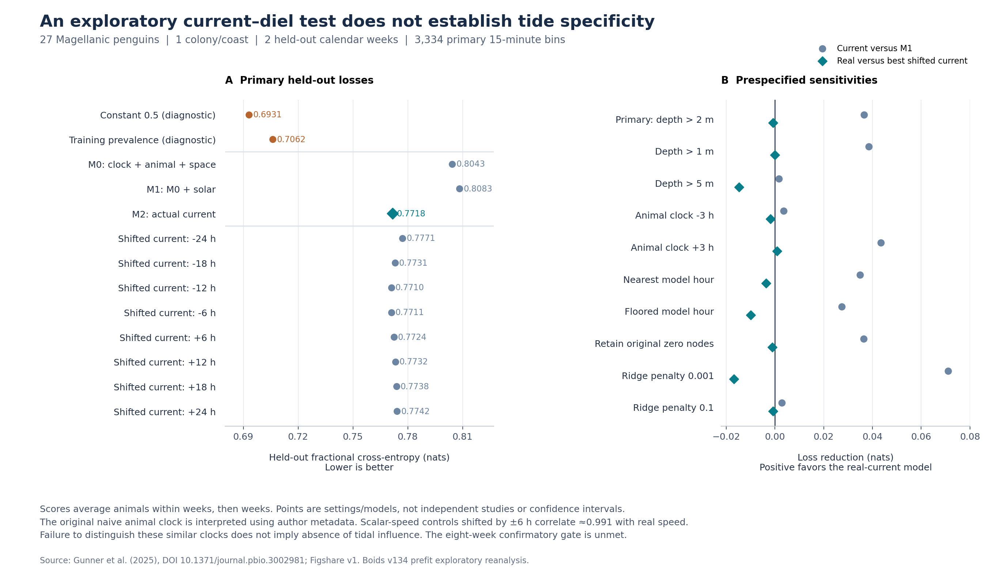

# v134：多分類群の文献判定と潮流・日周モデルの実データ検証

作成日：2026年11月14日。Boids の「潮汐と太陽・日周周期が生物の時間ニッチを組織する条件」を調べる継続研究。v133 の原著監査を拡張し、公開原データによる探索的解析を追加した。

## 1. 今回得られた結論

**文献118件の判定を整理し、60件から311件の数値記録を出典に結び付けた。新たに確認した公表値は、潮汐への応答が活動指標、生息場所、光条件、性別などによって異なることを示す。一方、同じ推定対象と不確実性をそろえた全球の統合効果は、今回も推定していない。**

118本は独立した118海岸ではない。311件も独立した効果量の数ではなく、係数、報告SE、比、記述統計、平滑項の検定などを含む記録数である。原著単位、同一個体・場所の反復、応答変数、潮汐の定義を保ったまま保存した。全1,061件の候補を網羅したレビューが完了した、という意味でもない。[R1–R3]

**公開データから実施したマゼランペンギン27個体の解析では、潮流を加えると指定した複雑な基準モデル内で損失は減ったが、単純な定数予測の方が良かった。主解析で実時刻と解釈した潮流は9通り中3位で、潮汐時刻に固有の予測優位性は示せなかった。** ただし、時刻をずらした流速系列も元の系列と非常によく似るため、この比較から「潮汐の影響がない」とは結論できない。1海岸・1種・2暦週の探索結果として位置付ける。[R4–R7]

## 2. 文献の拡張範囲と判定

### 2.1 選び方と到達範囲

既存の1,061件のメタデータから v132 が抽出した野外候補150件に加え、「関連性不確実」405件について、結果を見る前に固定した救済規則を適用した。元の潮汐・行動フラグが両方立つもの、または表題に tidal / tide / intertidal / circatidal があるものを対象とし、46件になった。効果の符号、有意差、データの入手容易性は選択に使っていない。元の v132 の判定は、保存された短い抄録抜粋だけでなく、取得した全文抄録を利用していた。[R1, R2]

| 段階 | 件数 | 解釈 |
|---|---:|---|
| 固定されたメタデータ集合 | 1,061 | 全球探索の出発集合 |
| 既存の野外候補へのアクセス確認 | 150 | このうち原著同定済みXML86件を今回判定 |
| 固定規則による追加候補 | 46 | 既存150件とは別の不確実群から抽出 |
| 追加候補の本文・同定確認 | 32 | HTTPエラー3件、PMC XML IDなし11件も台帳に残した |
| 今回の統合判定台帳 | **118** | 既存86件＋追加32件、DOI重複なし |
| 実質的本文が存在するもの | 117 | 1件は本文を欠くXMLで未解決のまま |
| 本文の実質的読解を行ったもの | 115 | 2件は表題・抄録で範囲外と判定し、本文読解とは数えない |
| 今回までの対象アクセス確認外 | 865 | 未確認部分を適格・不適格のいずれにも補完しない |

本文を欠く DOI 10.1007/s11802-022-5164-2 は、XML取得成功を全文確認成功と取り違えず、未解決とした。今回の118本のうち11本は v133 の17本の出典監査と重なる。残る107本はその17本に対して新規の判定であり、「新規の適格研究107本」ではない。モデル補助による原著読解と指定数値の独立照合であり、人間2名の独立スクリーニング・裁定を完了したPRISMAレビューとは表現しない。[R1–R3]

### 2.2 判定の内訳

| 判定 | 本数 |
|---|---:|
| 潮汐・日周を共同に扱う野外研究 | 20 |
| 潮汐・日周を別々に扱う野外研究 | 13 |
| 潮汐のみの野外研究 | 18 |
| 日周のみの野外研究 | 7 |
| 両周期のモデル内容が未確定の野外研究 | 1 |
| 時間的な環境曝露がない野外研究 | 1 |
| 実験室または半自然条件 | 21 |
| 行動・活動とは異なる応答変数 | 25 |
| 潮汐に関係するが時間的な曝露ではない | 5 |
| 総説・訂正 | 6 |
| 本文不足で未解決 | 1 |
| **合計** | **118** |

ここでの「共同に扱う」20本は、20本の最終的な共同回帰モデルや20件の潮汐×日周交互作用を意味しない。候補モデルで両者を検討して最終モデルでは潮汐だけを残した研究、両周期のスペクトル分類、通過窓を両方の条件で調べた研究も含む。実際のモデル形は各レコードの joint_model_status に記録した。加法効果、交互作用、候補から除外された項、未推定の項を区別している。[R2]

また、自然海水中の袋・保護チャンバーに入れた固着性カキについては、拘束があることだけで実験室研究に分類しない。Arcachon と Helgoland を、自然の潮汐にさらされた「拘束のある固着性動物の野外弁活動」という同じ設計層にそろえた。Arcachon の約15日区間は連続する25区間であり、重複区間とは記述しない。[S6, S7, R8]

## 3. 原表から確認した、比較に効く公表値

下表のβは各論文のモデル尺度にある。尺度の異なる行を平均したり、すべてを同じオッズ比に変換したりしていない。原著7本について同定・本文を確認し、そのうち6本の23組の係数・報告SEを独立に原表と照合した。[R8]

| 研究・応答 | 原表の値 | 解釈と統合上の制約 |
|---|---|---|
| オーストラリア Georges River の yellowfin bream：加速度活動 | 潮位 β=0.1785145、SE=0.035。光合成有効放射PAR β=0.1651113、SE=0.019。**PAR×潮位 β=0.1120134、SE=0.039、p=.005** | 連続量として標準化されたPARと潮位、対数変換した活動、GLS AR1（φ=.34）。表の「Diel period」「Tidal period」を二値の昼夜・満干潮に読み替えない。対数の底・標準化の詳細には未解決点がある。[S1] |
| Bahamas の lemon shark：1時間内の頭振り発生 | 上げ潮／下げ潮 0.012（SE .132）、満潮／下げ潮 **−0.600（.149）**、干潮／下げ潮 0.028（.144） | 周期的な時刻と季節を調整した採餌代理行動。ゼロと両立する比較も残した。満潮−干潮の点差は−.628だが、そのSEには係数間共分散が必要。[S2] |
| Argentina Caleta Valdés の sevengill shark：音響検出 | 雌の低潮位／高潮位 −.149（SE .041）、雄×低潮位 −1.042（.062） | 低・高潮位は予測潮位の下位・上位四分位。検出履歴に基づいて在域と扱われた日に限定した時間別検出という応答。雄の低潮位／高潮位の点差−1.191に対応するSEは共分散なしでは得られない。潮汐×性別であり潮汐×日周ではない。[S3] |
| ドイツ Wadden Sea の herring gull：採餌中の干潟対陸域の選択 | 潮位 **−.40、報告平均SE .04**。夜 .59、報告平均SE .08 | 37羽・1,115トリップ。14通りの間引き推定で使う行は異なるが、鳥・トリップと時間依存を共有する。平均SEを平均係数の正しい標本SEと断定しない。潮位単位も未確定。[S4] |
| Florida Outback Key のチドリ類：生息場所別個体数 | 干潟：Piping −.40（SE .15）、Snowy −.45（.07）、Wilson’s −.11（.03）。砂浜：順に **+.89（.06）、+.17（.07）、+.71（.05）** | 同一島・共通の朝38回調査。潮位・風の標準化と交互作用があり、潮位傾きは平均的な風条件での値。反対符号は生息場所間の再配置と整合し、活動の一様な増減ではない。[S5] |
| Helgoland の European flat oyster：開殻幅VOA・開殻時間割合VOD | 潮位のVOA傾き **+3.26（SE .72）**、VOD傾き **−4.47（1.10）** | Methodsから百分率ポイント／mと読める。同じ動物群でも応答によって符号が逆。全体モデルの光条件は季節的な日長であり、1日の中の昼夜位相ではない。残差の系列相関構造は明示されていない。[S6] |
| 中国 Cao’e 河口魚道：方向別通過回数／観測努力 | 3–6月の上げ潮後期／前期：上流向き **RR 1.669［1.067, 2.611］**、下流向き **1.499［1.036, 2.169］**。下げ潮後期／上げ潮前期：順に **.453［.270, .759］、.578［.382, .876］** | 95%CIは公表値。負の二項・対数リンク、観測努力offset、日付ランダム切片。季節×潮汐段階の交互作用であり、時計時刻との交互作用ではない。個体や種は同定できず、通過イベントの率である。[S8] |

チドリのついばみ速度では、Piping の潮位係数−.01（SE .08、p=.942）、Snowy の−.17（.10、p=.088）も残した。論文のモデル名・リンクの説明に不整合があるので、これらを個体数と同じ尺度の効果にはしない。Wilson’s に採餌観察がなかったことも、推定されたゼロ効果とは扱わない。[S5, R8]

bream では37,070件の活動測定の97.09%が3個体に集中しており、生物学的標本は6個体である。15,014のモデル用区間を15,014個体には数えない。lemon shark の20回の装着も18個体で、2個体の再装着を含む。これらの依存構造は公表SEの解釈と研究の重みに関わる。[S1, S2, R8]

### 統合できる単位を増やすための判定

直接加速度活動の候補群には bream、gray reef shark、blacktip reef shark がある。しかし、固定した潮位傾き、潮汐別の時刻平滑項、異なる活動尺度が混在し、同じ潮汐・光条件に対するコントラストと分散をそろえられていない。魚類の通過イベントでは Cao’e と既存の Maine が候補になるが、これだけで3つの独立海岸は成立しない。チドリ3種や同一カキの複数応答を海岸の独立反復に増やすこともしない。[R2, R3, R8]

したがって、現在の成果は「公表された潮汐応答にはどのような条件依存性があるか」を出典単位で示すことである。共通の推定対象・不確実性・独立海岸を確保する前に、異なる応答の符号だけで投票したり、共分散をゼロと仮定した統合値を作ったりはしない。

## 4. 原データ解析：マゼランペンギン

### 4.1 原データと事前に固定した解析

Gunner らの論文と Figshare v1 は、圧力深度、個体ID、時刻、推定位置、独立した海洋モデルの東西・南北流速を公開している。原論文は移動・航行を扱うが、今回の応答は**観測された時間のうち深度2mを超えた割合**とした。採餌成功や獲物捕獲イベントを復元したものではない。深度とモデル潮流を別の出所から組み合わせ、元の航行解析の再現とは区別した。[S9, S10, R4]

約932MBの元CSV2本を取得し、公開MD5とローカルSHA256を確認した。動物データは3,072,835行から完全一致の重複26行を除いた3,072,809秒で、27個体、9日付、経過時間約7.96日、2暦週にまたがる。1か所の2,582秒の欠測は補完していない。各個体の記録長は約10.5–52.4時間である。[R4, R6]

動物CSVの Timestamp 自体にはタイムゾーンがない。著者のリポジトリ説明にある DateTime=UTC を、この列に対応させる解釈を主解析とした。配布Rコードは動物時刻をタイムゾーン指定なしで読み込むため、UTCが独立に確証されたとは表現しない。一方、潮流の Hours=0 は **2019-11-22 01:00 GMT** で、00:00ではない。動物時計を−3時間・＋3時間ずらす感度解析を結果を見る前に定めた。[R4, R6]

主な固定条件は次のとおりである。完全な仕様は、変更していない[解析前仕様](V134_PENGUIN_PREFIT_ANALYSIS.md)に保存した。

- 非重複15分区間に集約し、900秒中720秒以上の実測がある区間だけを使う。欠測をゼロ行動にしない。
- 各区間の平均位置で元の海洋格子を線形空間補間し、平均観測時刻の前後の時刻でU/Vを線形時間補間する。外挿しない。
- 元の全240時刻でU/Vがゼロの格子点は6,157点ある。陸域マスクなのかは未確認のため、主解析は平均位置の補間三角形がその点に触れる区間を除く。元のゼロ点を残す設定も別に報告する。
- 実時刻の潮流と、±6・12・18・24時間の8つのずらした潮流を、同じ位置・同じ区間で比較する。周期を人工的に延長・折り返ししない。
- M0は個体、時計時刻の24/12時間成分、経過日、個体記録の経過時間、観測率、位置の項。M1は太陽高度・夜間を追加し、M2は流速・流速二乗・流速×夜間を追加する。
- 各暦週全体を順に除外して学習し、残した週を予測する。重みは学習個体ごとに等しく、標準化は学習データだけで行う。評価も区間→個体／週→週の順に平均する。

日周成分と太陽幾何は、この短期間では強く関係する。M1の増分から光の因果効果を同定する設計ではない。また、流速の大きさを用いた検証なので、流向を利用する航行機構をすべて検証したわけでもない。[R4]

### 4.2 除外と実際の独立単位

| 集計段階 | 15分区間数 |
|---|---:|
| 観測を含む区間 | 3,440 |
| 観測率基準を満たす区間 | 3,400 |
| 全時刻ずらし・時計感度で共通の潮流時間範囲 | 3,373 |
| 平均位置のゼロ格子点接触を除いた主解析 | **3,334** |

主解析に含まれる実測秒は3,000,423秒、夜間区間1,291、昼間区間2,043。2週の評価側は751区間・9個体と2,583区間・23個体で、5個体が両週に現れる。完全な個体外検証ではなく、時期と個体の両方が変わる移行性能を調べている。独立した海岸数は1である。v131 で固定した8週間以上の確認的解析の条件は満たさない。[R4–R6]

### 4.3 主結果：相対的な改善と予測性能を区別する

損失は fractional cross-entropy、単位はnatsで、小さいほど良い。数百万秒を独立試行として精度を水増しせず、前述の個体・週の階層で集計した。[R5]

| 比較 | 評価週の損失 |
|---|---:|
| 常に0.5を返す定数予測（事後診断） | **0.693147** |
| 学習個体から求めた平均割合の定数予測（事後診断） | **0.706177** |
| M0：時計・個体・位置など | 0.804310 |
| M1：M0＋太陽条件 | 0.808294 |
| M2：M1＋実時刻の流速 | **0.771751** |
| 最良の時刻ずらし：−12時間 | **0.770989** |

M0からM1への改善は−0.003984、M1からM2への改善は＋0.036543。しかし、実時刻と最良の時刻ずらしの差は **−0.000761** で、実時刻は9通り中3位だった。さらに、すべての主解析モデルが2つの単純な予測基準に劣る。したがって、＋0.036543だけを取り出して「潮流を使えば有用な予測ができる」とは述べない。[R5]

定数予測は、最初のモデル結果が log(2) を上回ったために追加した**事後的な性能診断**である。元のモデル、閾値、時刻ずらし、ペナルティ、学習・評価の分け方は変更していない。追加理由と、共有マスクの変異に関する修正・再実行は[事後診断記録](V134_POSTFIT_DIAGNOSTIC_LOG.md)に残した。[R7]

図：左は主解析と単純な予測基準の損失。右は事前指定した10設定における潮流追加の改善と、実時刻が最良のずらし時刻に勝る程度。点は設定・モデルであり、独立研究や信頼区間ではない。図と数値は今回の再解析による。[R5, R9]

### 4.4 感度と不確実性

| 設定 | 潮流追加の改善 | 実時刻−最良ずらしの優位性 | 実時刻の順位／9 |
|---|---:|---:|---:|
| 主解析：深度>2m | +0.036543 | −0.000761 | 3 |
| 深度>1m | +0.038505 | +0.000019 | 1 |
| 深度>5m | +0.001634 | −0.014774 | 5 |
| 動物時計−3時間 | +0.003559 | −0.001788 | 4 |
| 動物時計＋3時間 | +0.043383 | +0.000851 | 1 |
| 最も近いモデル時刻 | +0.034851 | −0.003582 | 5 |
| 直前のモデル時刻 | +0.027344 | −0.009965 | 5 |
| 元のゼロ格子点を保持 | +0.036452 | −0.001134 | 3 |
| ridge 0.001 | +0.071037 | −0.016877 | 5 |
| ridge 0.1 | +0.002820 | −0.000705 | 5 |

「実時刻の優位性」は、ずらした潮流の最小損失から実時刻の損失を引いた値であり、正なら実時刻を支持する。10設定のうち2設定で1位になるが、差は小さく、いずれも単純な予測基準には劣る。結果の良い設定を選んで主解析に変更していない。[R5]

元の流速と±6時間流速の相関は約.991、±12時間でも約.966–.968である。流速の大きさは流向を落とし、近い速さが周期内で繰り返される。このため、時刻をずらした比較対象も似た環境情報を保持する。元の時刻を識別できない結果は、潮汐機構が存在しない証拠にも、選んだずらし時刻が真の時刻である証拠にもならない。最良のずらし時刻を評価結果から選んでいるため、その損失は選択を含まない予測性能推定やランダム化検定のp値ではない。[R6]

個体単位の2,000回再標本化による95%区間は、潮流追加で［+.023877, +.051050］、実時刻の優位性で［−.002131, −.000102］だった。これは**同じ2週と学習済みモデルに条件付けた再標本化区間**であり、モデルを毎回再学習したものでも、独立した週や海岸に対する信頼区間でもない。メタ解析のSEには変換しない。[R5, R6]

### 4.5 平均位置による曝露近似の確認

各15分区間の位置範囲の対角長は中央値1.164km、95パーセンタイル2.175kmで、約1kmの格子に対して無視できない移動を含む。独立検証では、同じ3,334区間について、秒ごとに接続した潮流を実測秒で加重集約し、平均位置を使った値と比較した。直前時刻・最近時刻のRMSEはそれぞれ.004163、.004382m/s、相関は約.99995で、典型的な差は小さかった。一方、最大差は.094401m/sである。[R6]

これは直前・最近時刻の曝露近似の確認であり、主解析の線形時間補間や推定効果の変化を独立に保証するものではない。また、保持した27区間には、区間内の元の位置ではゼロ格子点に接触する5,980秒が含まれる。主解析の除外は**区間の平均位置**に適用しているため、「保持区間の全観測位置がマスクの影響を受けない」とは言えない。結果を見てマスクを変更せず、仕様どおりの解析とこの限界を記録した。[R6]

## 5. より長い・複数分類群の原データで判明した障害

短いペンギン系列だけで全球課題を進めることを避けるため、長期魚類系列、魚道、カキ、音響群集の公開原データも監査した。

| 原データ | 今回確認したこと | 新しい応答モデルに進むために必要なこと |
|---|---|---|
| Rhine–Meuse 河口、1996–2018年、4TU | 元ZIP約122MBとREADMEを取得・ハッシュ確認。HVS進入の中間表200個体、最終193個体との対応。受信機の設置時期や最初・最後の記録はあるが、稼働・停止の区間履歴がない | **水門が通過可能だった時間と、受信機が観測していた時間を分ける。** 受信機の実稼働時間が分からない状態では、無検出時間をゼロ通過として作れない。個体リスク集合も別問題。[S11, R10] |
| Cao’e 河口魚道 | 30日付・8暦週、実測961組の30分区間＝480.5時間。上流向き248・下流向き292の数値ゼロと、各方向479の未監視記号「/」を区別できる | 潮位288点の1日列が、2025-05-16と2026-06-04、2025-05-17と2026-06-05でそれぞれ完全一致する。由来・意図の説明は確定していない。潮汐を使う再推定の前にこの対応を解決する。[S8, R11] |
| Helgoland カキの長期弁活動 | 論文は540日。公開PANGAEAメタデータは2027-07-10まで公開猶予と明示。メタデータの2024–2025年と論文の2023–2024年には日付差がある | 利用可能な原データと日付の対応確認が必要。現段階では原表係数までで、原データ解析を実施したとはしない。[S6, S12] |
| ヨーロッパのケルプ林の魚類音響群集 | 元XLSXを取得。20選択日、保持421時間、26音型。高潮時などの流動雑音で59時間が除かれている | 26音型を26種と数えない。時刻帯、音型同定、雑音による検出・欠測、除外時間の情報と標準化をそろえる。[S13, R12] |

Rhine–Meuse の環境表では同一時刻の超過行17,691件、値の異なる重複時刻54件も確認した。素朴な行数集計では時間を約1.98%過大に数える。水門の機会、受信機の観測努力、個体の到達・生存を同一の分母にしない。この系列でモデルを実行しなかった理由は観測過程の未確定であり、「潮汐効果が弱いから」ではない。[R10]

魚道の完全一致列についても、意図的な不正や原因を推測していない。元ファイルを保存し、確認できた一致だけを記録した。公表比は公表比として保持し、新たな潮汐モデルの入力検証とは分けている。[R11]

## 6. 検証と再現性

各文献の判定にはDOI、元XMLのSHA256、本文の有無、原表・節、判断理由を付した。集約表から元の判断・数値へJSON pointerで戻れる。公表係数の照合では、欠けている共分散をゼロとして補わず、導出できる点差と導出できないSEを別々に示した。[R2, R3, R8]

数値レビューは、元の約3百万行の動物データと550万行の潮流データも再読した。独立した補間経路で81列の曝露を照合し、最大差は4.3×10⁻⁹m/s以内。別のNewton/Hessian最適化と階層集計による主解析11モデルの損失差は最大9.1×10⁻⁷natsで、順位・解釈は変わらなかった。後者は確認済みの特徴量構築を再利用しており、全コードを独立に再実装した検証とは表現しない。[R6]

回帰テストは、原著同定、欠測分母、重複の衝突、時刻原点、外挿禁止、マスク、週単位の分離、学習データだけの標準化、個体・週集計、共有入力の意図しない変異を対象とする。v131–v134の84件のテストが通過し、118件の元XMLと全10設定の再実行を含む3,707件の整合性チェックも通過した。再実行による損失の最大差は0だった。保存済み結果の検証と、公開可能な派生入力からの全10設定の再実行をCIに組み込んだ。CIで約932MBの元データを毎回取り直したとは主張せず、元ファイルの完全な照合記録と派生入力の再実行範囲を分ける。[R13]

最終の独立レビューで見つかった文言上の3点を修正し、未解決の重大・中程度の指摘は残っていない。原著の対比区分と検出条件、文献数の意味、時計解釈の条件付けを確認した。[R14]

実行コマンド、ファイル一覧、原データの取得先、ライセンスは [validation_v134/README.md](../validation_v134/README.md) にまとめる。ペンギンの派生15分入力は、元データのCC BY 4.0に従い出典と改変内容を明示して保存した。4TUの元ZIPはCC BY-NC-NDであり、変更した原データを配布していない。[R4, R10]

## 7. 全球統合に残る具体的な条件

次段階で必要なのは、単に論文数を増やすことだけではない。まず、加速度活動、場所の利用、通過イベント、開殻という応答ごとに、同じ潮位・流速コントラストと光条件を定義し、原データまたは公表モデルからその推定値と共分散を得る。次に、個体・年・論文の重なりを確認した独立海岸を確保する。今回確認した魚道の潮位対応、長期受信系列の観測努力、動物時計の根拠は、その前提となる具体的な未解決点である。

今回の台帳は、採用できない研究もその理由ごと残すため、この作業を再探索から始めずに済む。現段階では、潮汐への応答の条件依存性を複数分類群の原著数値で示しつつ、全球の効果量および潮汐と太陽の相対的重要性を数値一つに確定することは保留する。

## 出典・成果物

### 原著・原データ

- **S1** bream：[10.1371/journal.pone.0080962](https://doi.org/10.1371/journal.pone.0080962)、Table 4（pone-0080962-t004）、標本数はTable 1。
- **S2** lemon shark：[10.1007/s00227-018-3318-y](https://doi.org/10.1007/s00227-018-3318-y)、Table 8、装着個体はTable 2。
- **S3** sevengill shark：[10.1098/rsos.230667](https://doi.org/10.1098/rsos.230667)、Table 2（RSOS230667TB2）。
- **S4** herring gull：[10.1002/ece3.4167](https://doi.org/10.1002/ece3.4167)、Table 3（ece34167-tbl-0003）。
- **S5** Florida plovers：[10.3390/ani13223548](https://doi.org/10.3390/ani13223548)、Tables 1–2。
- **S6** Helgoland oyster：[10.1038/s41598-026-63105-x](https://doi.org/10.1038/s41598-026-63105-x)、Table 1、Methods。
- **S7** Arcachon oyster：[10.1371/journal.pone.0185918](https://doi.org/10.1371/journal.pone.0185918)、Methods sec003/sec006。
- **S8** Cao’e fishway：[10.3390/ani16193014](https://doi.org/10.3390/ani16193014)、Tables 3–4、Dataset S1、Supplementary material。
- **S9** Gunner et al. (2025)：[10.1371/journal.pbio.3002981](https://doi.org/10.1371/journal.pbio.3002981)。
- **S10** ペンギン元データ：[Figshare v1、10.6084/m9.figshare.28517873.v1](https://doi.org/10.6084/m9.figshare.28517873.v1)、CC BY 4.0。
- **S11** Rhine–Meuse：[10.1186/s40462-026-00667-5](https://doi.org/10.1186/s40462-026-00667-5)；[4TU元データ](https://doi.org/10.4121/e8d5fe1e-773c-475c-b2c3-bf5b9def961a)。
- **S12** カキ公開メタデータ：[PANGAEA.983652](https://doi.pangaea.de/10.1594/PANGAEA.983652)、[PANGAEA.983653](https://doi.pangaea.de/10.1594/PANGAEA.983653)。
- **S13** ケルプ林音響群集：[10.1186/s12862-026-02521-z](https://doi.org/10.1186/s12862-026-02521-z)。

### 今回の解析・監査記録

- **R1** [集計とアクセス範囲](../validation_v134/results/evidence_summary.json)、[追加アクセス台帳](../validation_v134/results/rescue_access_audit.json)、[事前仕様](V134_MULTITAXON_SCREEN_AND_IPD_SPEC.md)。
- **R2** [118本の正規化判定](../validation_v134/results/normalized_study_decisions.json)、元台帳 [A](../validation_v134/fulltext_screen_a.json)・[B](../validation_v134/fulltext_screen_b.json)・[追加32本](../validation_v134/rescue_fulltext_screen.json)。
- **R3** [311件の数値記録](../validation_v134/results/reported_numeric_records.csv)。
- **R4** [原データ監査](../validation_v134/penguin_original_source_audit.json)、[集約・接続監査](../validation_v134/results/penguin_analysis_source_audit.json)、[解析前仕様](V134_PENGUIN_PREFIT_ANALYSIS.md)。
- **R5** [全設定の解析結果](../validation_v134/results/penguin_analysis_results.json)、[個体・週単位の評価値](../validation_v134/results/penguin_primary_animal_week_scores.csv)。
- **R6** [独立数値レビュー](../validation_v134/INDEPENDENT_NUMERICAL_REVIEW.md)、[補間・集計の照合](../validation_v134/penguin_independent_verification.json)、[別最適化による照合](../validation_v134/penguin_independent_refit.json)、[曝露近似の評価](../validation_v134/penguin_exposure_approximation.json)。
- **R7** [事後診断・修正記録](V134_POSTFIT_DIAGNOSTIC_LOG.md)。
- **R8** [公表値の独立レビュー](../validation_v134/INDEPENDENT_PUBLISHED_EFFECT_REVIEW.md)、[23組の係数・SE照合](../validation_v134/published_effect_verification.json)。
- **R9** [結果図PNG](../validation_v134/figures/penguin_current_diel_validation.png)、[SVG](../validation_v134/figures/penguin_current_diel_validation.svg)。
- **R10** [長期魚類系列の観測努力監査](../validation_v134/fish_longterm_source_audit.json)、[元データのプロファイル](../validation_v134/fish_longterm_data_profiles.json)。
- **R11** [魚道元データの構造・一致列監査](../validation_v134/fishway_raw_inventory.json)。
- **R12** [ケルプ林元データ監査](../validation_v134/kelp_raw_inventory.json)。
- **R13** [ローカル整合性・再実行の検証記録](../validation_v134/results/local_verification_receipt.json)、[公表原表の再照合記録](../validation_v134/results/local_published_source_replay.json)。

- **R14** [最終の独立科学レビュー](../validation_v134/FINAL_SCIENTIFIC_REVIEW.md)。
