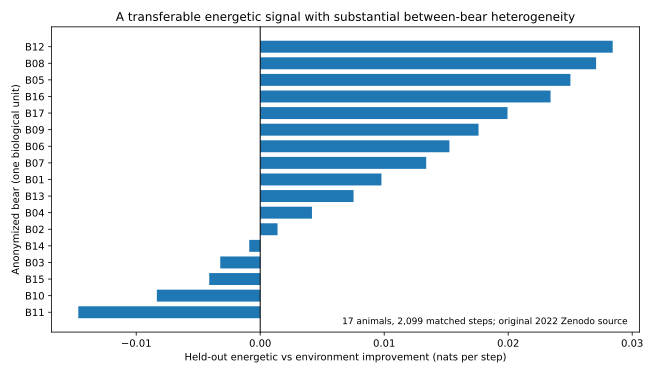

# v9 — Energetic descriptions of movement choice transfer among unfamiliar polar bears

**実測解析 2026-11-16 / Exploratory secondary original-data reanalysis; NOT a confirmed cross-taxon causal mechanism.**

## Main biological question

Do environmental representations generalize among individuals, or can resource gain and movement cost provide a more transferable representation of *which movement among simultaneously generated candidate endpoints is used*?

This is intentionally narrower than the earlier `Shared places, different ecological lives` hypothesis: **the source does not record the environmental state at the true step origin, so it cannot establish state retention, refuge-seeking, or niche switching conditional on origin.**

## Verifiable origin and provenance

- Published original tracking/analysis source: Klappstein, N. J., Potts, J. R., Michelot, T., Börger, L., Pilfold, N. W., Lewis, M. A. & Derocher, A. E. (2022), *Journal of Animal Ecology*, DOI [10.1111/1365-2656.13687](https://doi.org/10.1111/1365-2656.13687).
- Data/code: CC BY 4.0 open Zenodo [10.5281/zenodo.6319709](https://doi.org/10.5281/zenodo.6319709), `ESF_Rcodes.zip`, 18,023,548 bytes; provider original MD5 `20bcf2babfc97c088f9b5948db23b5f1`, verified downloaded SHA-256 `943254e09a6043da98545832b0f2dab4f15130a71e91fe2445ef424f8fe6de7e`.
- Source CSV used for identical candidate support across models: `data/model_comparison_data.csv`, **174,804** original rows and **8,324** original step groups, 23 original bear-ID tokens. Source columns: `bearID, trackID, stratum, obs, GPS_step, bear_step, angle, gain, cost, ice, drift, depth`.
- GitHub Actions runs [43885029482](https://github.com/zuizui0223/boids/actions/runs/43885029482) and [43885155798](https://github.com/zuizui0223/boids/actions/runs/43885155798) independently replay original downloads and give **byte-identical actual result JSON** with SHA-256 `d815b93c0c5ea751b14d7850379227ce670b8813b53a98d3f9821c5d248a7add`; the second run includes a performance-only index-loop fix, with unchanged data/model numerics.

## Frozen comparative endpoint, evaluated exactly once on original numeric effects

- Eligibility chosen before original numeric values opened: 1 source-marked used candidate and >=5 source candidates for each unique `bearID × trackID × stratum`, finite observations for *all* fixed predictors, physical nonnegative step lengths, original sea-ice concentration between 0 and 1, fixed minimum 50 source groups per eligible bear, at least 15 bears and at least 1,000 eligible groups.
- Source standardized **common support** after exclusions: **17** bear IDs, **2,099** original matched-used/available step groups and **44,079** candidate rows. Thus **6/23 bear IDs** and **6,225/8,324 groups** are not represented in the primary target; excluded candidate rows: **130,725/174,804 (74.8%)**. This is a substantial selection domain limit.
- Entire *bear IDs* are assigned to 5 deterministic SHA256 folds (group counts 6/2/2/3/4). No test bear observation contributes to training or standardization. Each training bear contributes equal total weight. No random-row cross-validation.
- Fixed conditional multinomial choice among **source-generated** candidates. Fixed penalized conditional logit (ridge penalty λ=0.02), training-only standardization, common conditional-likelihood scoring in held-out bears. The training source and target both belong to the same polar-bear study, not a new population or another species.
- Four predefined feature representations: M0 = log source step length(s) + cosine turning angle; M1 = M0 + ice + ice squared + drift + sea depth; M2 = M0 + source energetic gain and cost; M3 = M0 + all M1 and M2 features. Covariate values were standardized on training bears only. Original gain/cost may already encode ice and movement information; models are not causally independent treatments.
- Each bear is one independent summary, rather than treating 44,079 alternative candidate rows as biological replicates. Percentile intervals use 10,000 whole-bear bootstrap resamples (seed 20261116) conditional on the fixed model-family/fold structure; they do not account fully for hypothetical future model-refit uncertainty.
- Frozen directional PASS rule: bear-equal 95% interval strictly above 0 **and** at least 65% of bear-level contrasts positive. Merely showing a positive interval does not override the bear-consistency gate.

## New empirical results (held-out mean negative log-probability, nats per candidate-choice event)

| Fixed model | Average held-out loss (lower is better) |
|---|---:|
| M0 movement only | 0.947576 |
| M1 + environment | 0.942665 |
| M2 + energetic gain/cost | **0.933148** |
| M3 + environment and energetics | 0.932348 |

| Frozen improvement, positive is better | Equal-bear gain, nats/event | Bear bootstrap 95% | Positive bears | Fixed verdict |
|---|---:|---|---:|---|
| M1 vs M0: environment | +0.004910 | [+0.002108, +0.007779] | 14/17 | PASS |
| **M2 vs M1: energetic representation (primary)** | **+0.009518** | **[+0.003445, +0.015423]** | **12/17** | **PASS** |
| M3 vs M1: environment + energetics | +0.010317 | [+0.004035, +0.016387] | 12/17 | PASS |
| M3 vs M2: added environment | +0.000800 | [+0.000115, +0.001625] | 11/17 | **FAIL** (bear-consistency) |

Primary improvement translates to only ~**1.01% lower** mean cross-entropy relative to M1 (0.009518 / 0.942665), or a ~**0.96%** geometric increase in probability assigned to actual choices (`exp(0.009518)-1`), not a 1% improvement in correct-place/top-choice accuracy. Each bear has 52–281 eligible groups; five bears are worse under M2 than M1, with observed gain range approximately **−0.01467 to +0.02843 nats/event**. No universal individual preference is established.

## Ecological significance and hard claim ceiling

**Supported:** Among 17 eligible animals in this one source, a model using original energetic gain/cost plus movement features transferred better to unfamiliar individuals than an environmental ice/depth/drift representation plus the same movement features, under the frozen common-support and model specification. The direction was positive for 12 of 17 bears, with meaningful heterogeneity and a relatively modest average gain. This lends support to the idea that a functional gain–cost representation can preserve some transferable predictive structure across animals despite differences in experienced habitats.

**Not supported or tested:** The paper's underlying energy selection theory was already published; this is **not** a first discovery of energy-based polar-bear selection. Strong causality, learning, actual energy expenditure, food capture or individual fitness are **not** directly measured by this reanalysis. The dataset has no original at-origin habitat state variable or time-stamped full geographical choice surface, so **does not test** state tracking, switching, state portfolio exhaustion, or same-location coexistence. Its five partitions are within one research study and are not independent new ecological populations; 74.8% of original rows are outside the common estimable domain.

## Relationship to four-system synthesis

- Serengeti: species may have differing time-use distributions in a shared mapped site.
- Bats: some individuals retain repeatable 3D use profiles without spatial exclusion.
- King Rails: used water depth may be buffered despite variation in locally available depth.
- **This polar-bear test:** a functional description of movement choice may predict *new individuals* better than raw environmental descriptors, even while individual contrasts remain heterogeneous.

These are **four distinct inferential objects**, not a measured universal mechanism. A focused future original research experiment must observe individual, movement-origin state, true destination, and reachable alternatives in the same step, then evaluate transfer across independent groups. This result should remain a supporting comparison in the synthesis or a transparent source-specific secondary analysis, rather than being presented alone as proof of a general cross-taxon law.

## Reproduction

Run `python ecostate_v9/bear_transfer_v9.py ecostate_v9/results/original_bear_transfer_v9.json` with Python 3.11, numpy, scipy, pandas. Source raw bytes re-fetched from the official Zenodo API, verified with the two fixed checksums above. Input original GPS/candidate rows are not redistributed. Known-truth tests: `PYTHONPATH=ecostate_v9 python -m unittest discover -s ecostate_v9 -p test_transfer.py -v`.
